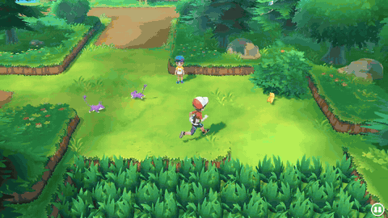
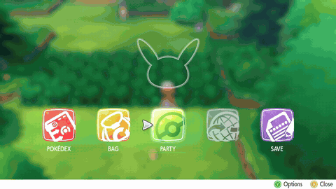
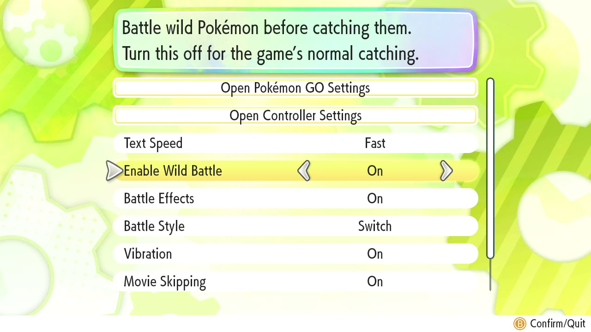

# The Better Let's Go

## AI disclosure

**This project is AI-assisted, about 95% overall by my estimate.** That's a judgement, not a measurement.

| Work | Done by |
|---|---|
| Reverse engineering, patch code, build scripts, documentation | Claude (Anthropic's AI), essentially 100% |
| Feature ideas, design decisions, what to keep or drop | The project owner |
| All testing on real hardware | The project owner |

The AI can't run the game, so every result below comes from the owner testing on a Switch. Expect mistakes, and please report them.

## About

A patch for **Pokémon: Let's Go, Pikachu!** on modded Nintendo Switch. It lets you battle wild Pokémon, with EXP and evolution, and catch them when you choose.

> **Status: early pre-release, not fully tested.** Back up your saves. See [Testing status](#testing-status).

## See it in action

| Enable Wild Battle: **On** | Enable Wild Battle: **Off** |
|---|---|
|  |  |

The option in the Options menu:



## Features

All of these can be switched off in-game, except the intro skip.

| Feature | What it does |
|---|---|
| **Wild battles** | Wild encounters start a real battle instead of going straight to catching |
| **EXP on a win** | Winning gives EXP, then any evolution, then back to the overworld |
| **Catch from the Bag** | Pick a Poké Ball in the battle Bag to end the battle and open the catch screen, starting on that ball. You get EXP if you catch it, none if you run |
| **No battle timer** | The time limit on these battles is removed |
| **Works on early saves** | Works before "Play with Pikachu" unlocks, and on a brand-new save |
| **"Enable Wild Battle" option** | On/Off in the Options menu, saved with your game. On by default. Off uses the original catching mechanic |
| **Intro skip** | Press **+** or **−** during the running Pikachu to jump to the title screen. Works whatever the option is set to |

"Presented By" can't be skipped.

## Requirements

| Requirement | Details |
|---|---|
| Console | Nintendo Switch running custom firmware with [Atmosphère](https://github.com/Atmosphere-NX/Atmosphere) |
| Game | **Pokémon: Let's Go, Pikachu!** only. Eevee isn't supported |
| Game version | **1.0.2**, with the update installed |
| Title ID | `010003F003A34000` |
| Build ID | `C208DB6A4EF4361F28B8402BE0F7CD9A` |

The patch only applies to this exact build. On any other version it does nothing.

## Installation

1. **Back up your save** with a tool such as JKSV or Checkpoint.
2. Remove any other wild battle mods, including the original Wild Battles. They change the same code.
3. Download the zip from [Releases](../../releases).
4. Unzip it to the root of your SD card, merging with the existing `atmosphere` folder.
5. Fully close the game (press X on the HOME menu), then start it again.

The patch ends up here:

```
/atmosphere/exefs_patches/the_better_lets_go/C208DB6A4EF4361F28B8402BE0F7CD9A00000000000000000000000000000000.ips
```

**To uninstall,** delete the `the_better_lets_go` folder. The option's saved value is one otherwise unused bit, and nothing was seen to use it without the patch, but this hasn't been tested over a long save, so keep your backup.

## How to play

- **Battle:** walk into a wild Pokémon as usual.
- **Catch:** open **Bag** in battle and pick a Poké Ball.
- **Turn it off:** go to **Options → Enable Wild Battle**.

Beating a Pokémon gives no chance to catch it, so **pick a ball before you finish the fight**.

## Warnings

- **Legendaries and Snorlax:** with the option On, beating one means you can't catch it, and it may be gone for good. Save first, and pick a ball instead of finishing the fight.
- **Stay offline.** Stay out of GO Park, and don't use online features with this patch. Modified games can get your console banned, and the patch overwrites part of a library that handles online data, which could crash if online features ever used it.
- **Story catches:** a scripted catch might not count if you win the battle instead. This is untested. If a story moment hangs or repeats, turn the option Off.

## Known limitations

- **Japanese:** the option doesn't appear, so the patch stays On. The option reuses the Hiragana/Kanji row, which Japanese players need.
- **Other languages:** the option's text is in English in every language for now.

## Testing status

Tested by the author on one Switch. **This build changed how the code is organised, so older results below need rechecking.**

| Area | Status |
|---|---|
| Options row, text and saving the choice | Tested |
| Catch screen opening on the picked ball | Tested on an earlier build |
| + and − skipping the running Pikachu | Tested on an earlier build |
| Timer, EXP on a win, evolution, early saves | Tested on an older version of the project |
| Option Off restoring the original mechanic | Tested |
| No catch screen after a win, catch EXP, ball count | Tested |
| Losing, running, trainer battles, long sessions | Tested |
| Shiny and Special Encounters | **Not tested** |
| A full playthrough | **Not done** |

## Building from source

This needs your own decompressed `main` from the game (1.0.2), with its 0x100-byte header still attached. No game files are in this repo.

```
pip install capstone
python tools/build_patch.py path/to/main_uncompressed.bin output.ips
python tools/package_release.py output.ips dist/The-Better-Lets-Go.zip
```

The script checks every original instruction before patching and stops if the game doesn't match. See [docs/TECHNICAL.md](docs/TECHNICAL.md) for how the patch works.

## Credits

**Inspired by [Wild Battles](https://gamebanana.com/mods/729162) by Rico-Santos.** The idea of battling wild Pokémon before catching them comes from that mod.

This project started as personal fixes to that mod, and its code was studied during development. The code here was then written independently and needs no part of it, and no files from that mod are in this repo. Because it was studied, this is **not** a clean-room rewrite, and some of the logic is necessarily similar, since both change the same game behaviour. Wild Battles is licensed CC BY-NC-ND, so please respect its terms and download it from its own page.

Also built with [Atmosphère](https://github.com/Atmosphere-NX/Atmosphere), which applies the patch, and [Capstone](https://www.capstone-engine.org/), used by the build script.

## License

Copyright (C) 2026 feelingdev. This project is licensed under the [GNU General Public License v3.0](LICENSE) (GPL-3.0). You can use, change and share it, but any version you distribute must also make its source available under the same license. It comes with no warranty.

The license only covers this project's own code, not the game or anything owned by others.

## Legal

This is an unofficial fan project, and isn't affiliated with or endorsed by Nintendo, Game Freak, Creatures Inc. or The Pokémon Company. Pokémon is a trademark of its respective owners. You need your own legal copy of the game. This repo contains no game files, keys or ROMs, and the patch contains its own code plus a few of the game's instructions it has to relocate. The images in `docs/images` are captures of the game, used to show what the patch does, and they aren't covered by this project's license. Use it at your own risk.
